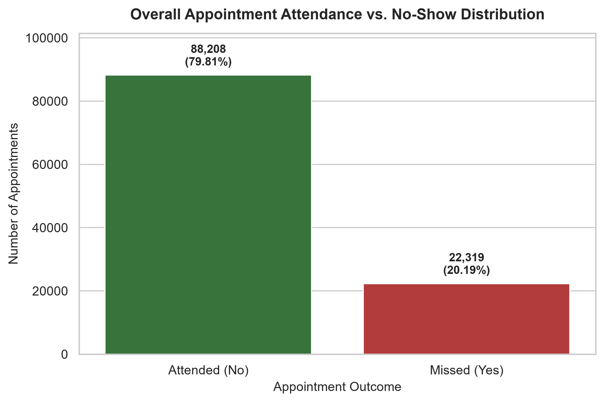
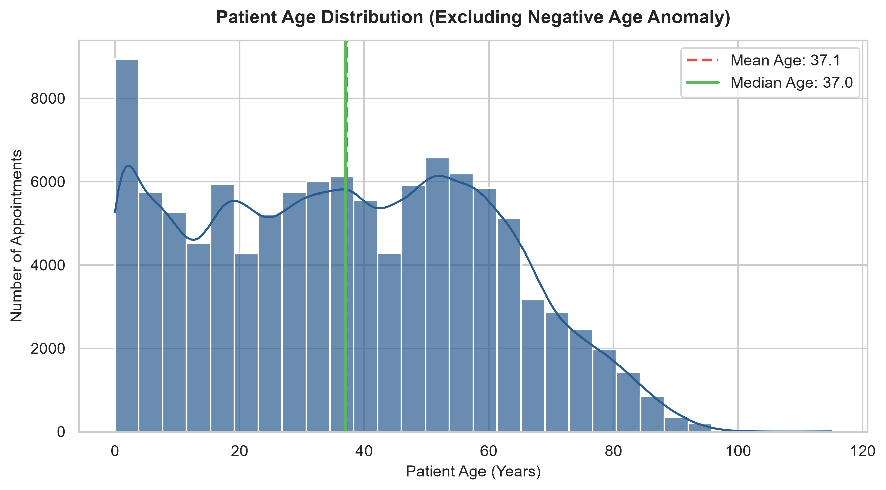
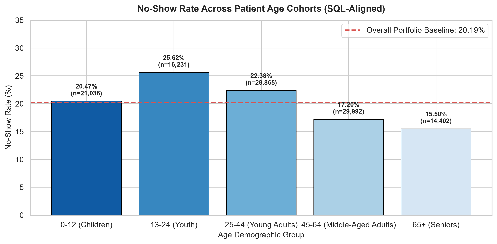
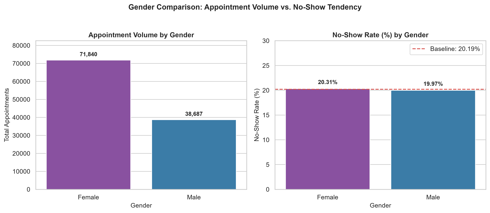
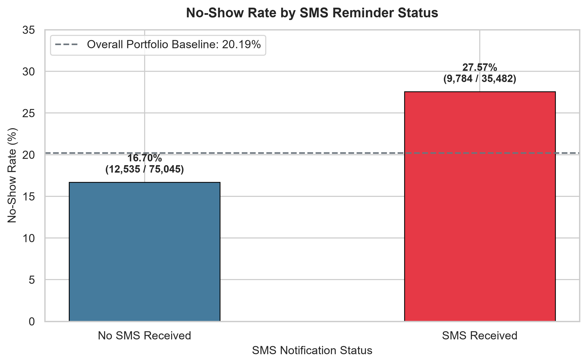
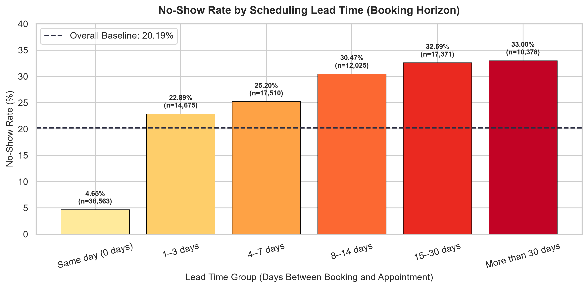
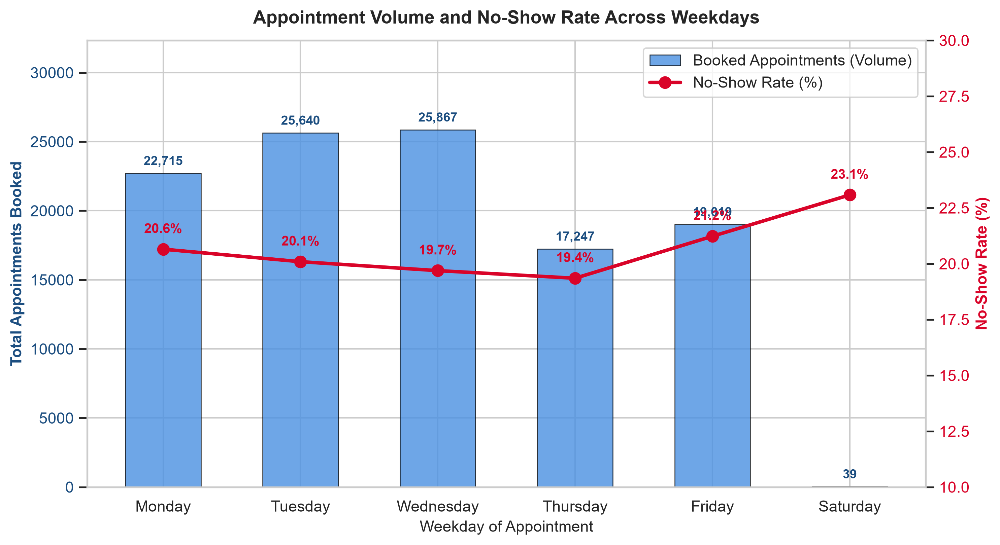
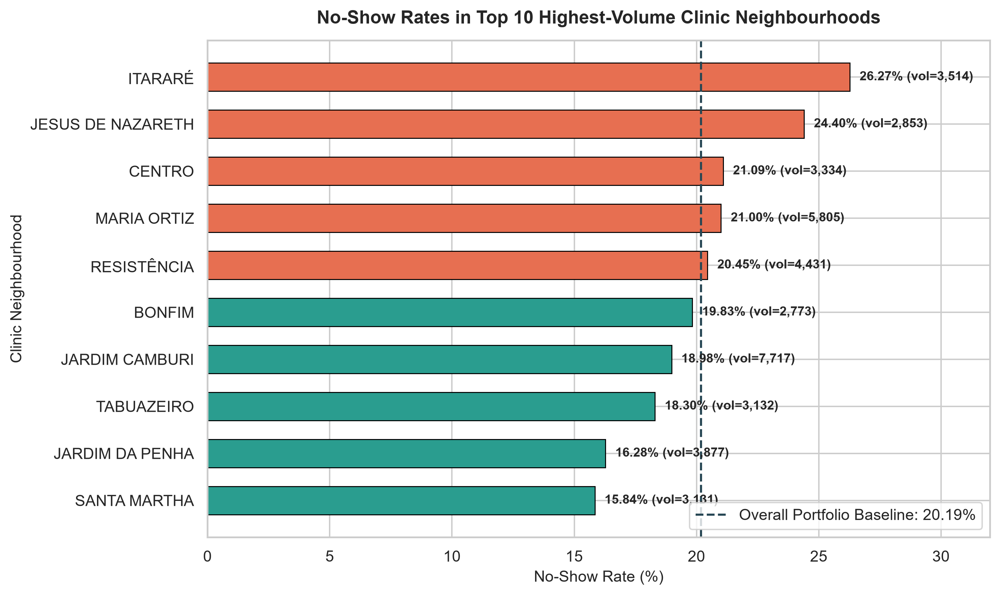

# Healthcare Appointment Access and Attendance Analysis

A complete, beginner-friendly data analytics portfolio project investigating patient appointment attendance patterns, operational scheduling bottlenecks, and behavioral attendance drivers across public healthcare facilities.

---

## Project Overview

In outpatient healthcare management, missed appointments ("no-shows") result in unused clinical capacity, lengthened waiting lists for other patients, and disrupted continuity of preventative care.

This project investigates **110,527 medical appointment records** across public clinics in Vitória, Brazil. By combining **SQL (SQLite)** data modeling with **Python (Pandas, Matplotlib, Seaborn)** exploratory data analysis, the project identifies key operational factors influencing whether a patient keeps or misses a scheduled consultation.

---

## Business Problem & Objectives

### Problem Statement
Healthcare clinics operate with fixed provider staffing and consultation hours. Unplanned absences reduce clinical resource utilization and lower the operational efficiency of outpatient facilities.

### Project Objectives
1. **Model Relational Data in SQLite:** Design a structured schema with data types, primary keys, and indexing.
2. **Execute Multi-Dimensional SQL Queries:** Compute high-level portfolio KPIs, demographic segmentations, and operational distributions.
3. **Conduct Comprehensive Python EDA:** Clean anomalies, test statistical interactions, and uncover confounding variables (such as the relationship between SMS notifications and lead time).
4. **Deliver Publication-Ready Visualizations:** Generate high-resolution figures communicating core findings.
5. **Formulate Data-Driven Operational Recommendations:** Propose evidence-based interventions to improve schedule utilization.

---

## Dataset Source

- **Dataset:** [Medical Appointment No Shows Dataset](https://www.kaggle.com/datasets/joniarroba/noshowappointments) (Kaggle).
- **Total Records:** `110,527`
- **Columns:** `14`
- **Unique Patients:** `62,299`
- **Dataset File:** `data/raw/KaggleV2-May-2016.csv`

---

## Technology Stack

- **Database:** SQLite 3 (managed via DB Browser for SQLite and Python `sqlite3`)
- **Programming Language:** Python 3.13
- **Data Manipulation:** Pandas, NumPy
- **Data Visualization:** Matplotlib, Seaborn
- **Interactive Prototyping:** Jupyter Notebook (`.ipynb`)
- **Version Control:** Git & GitHub

---

## Project Folder Structure

```text
health_data/
│
├── healthcare_analytics.db          # Root SQLite database (excluded from git)
│
├── data/
│   ├── raw/                         # Raw Kaggle CSV dataset (excluded from git)
│   │   └── .gitkeep
│   └── processed/                   # Cleaned datasets ready for reporting
│       └── .gitkeep
│
├── sql/                             # SQLite-compatible SQL scripts
│   ├── 01_table_creation.sql        # Schema definition and indexes
│   ├── 02_data_quality.sql          # Data hygiene, null and duplicate checks
│   ├── 03_kpi_analysis.sql          # Core portfolio KPIs and demographic splits
│   ├── 04_attendance_outcome_analysis.sql # Outcome distributions across cohorts
│   └── 05_operational_analysis.sql  # Lead time, weekday demand & repeat visits
│
├── scripts/                         # Python automation scripts
│   ├── import_data.py               # Safe CSV-to-SQLite ingestion pipeline
│   └── verify_database.py           # Database inspection and verification tool
│
├── notebooks/                       # Documented exploratory workflows
│   └── healthcare_eda.ipynb         # 20-section end-to-end Python EDA notebook
│
├── visuals/                         # High-resolution (300 DPI) exported figures
│   ├── 01_outcome_distribution.png
│   ├── 02_age_distribution.png
│   ├── 03_noshow_by_age_group.png
│   ├── 04_noshow_by_gender.png
│   ├── 05_noshow_by_sms.png
│   ├── 06_noshow_by_lead_time.png
│   ├── 07_weekday_analysis.png
│   └── 08_top10_neighbourhoods.png
│
├── reports/                         # Business reports and executive summaries
│   └── business_insights.md         # Comprehensive analytical findings report
│
├── README.md                        # Project documentation and guide
├── requirements.txt                 # Python dependencies
└── .gitignore                       # Git exclusion rules
```

---

## Data Quality & Validation Summary

Before conducting exploratory visualization, a thorough data quality audit was conducted:
- **Completeness:** 110,527 records loaded with **zero missing values** across all 14 columns.
- **Uniqueness:** **Zero duplicate appointment IDs** (primary key integrity confirmed).
- **Anomalies Identified:**
  - 1 record recorded `age = -1` (clerical entry error).
  - 5 records recorded a `scheduled_day` occurring after `appointment_day` (negative lead time).
- **Hygiene Architecture:** The underlying SQLite database was preserved intact; anomalies were filtered using separate in-memory analytical subsets.
- **SQL & Python Reconciliation:** Cross-validated between SQL and Python to confirm matching KPI metrics and age-group classifications.

---

## Key Performance Indicators (KPIs)

| KPI Metric | Value | Meaning |
| :--- | :---: | :--- |
| **Total Appointments** | **110,527** | Total scheduled appointments logged in the system. |
| **Unique Patients** | **62,299** | Distinct individuals booked across all clinics. |
| **Attended Appointments** | **88,208** | Completed consultations (`no_show = 'No'`). |
| **Missed Appointments** | **22,319** | Unattended consultations (`no_show = 'Yes'`). |
| **Portfolio Attendance Rate** | **79.81%** | Overall capacity utilization for completed appointments. |
| **Portfolio No-Show Rate** | **20.19%** | Overall benchmark rate of patient non-attendance (~1 in 5). |
| **Average Visits per Patient** | **1.77** | Average booking frequency per patient. |

---

## Key Analytical Findings

1. **Lead Time is the Dominant Factor:**
   - Same-day bookings (0 days notice) achieve an attendance rate of **95.35%** (only 4.65% no-show).
   - Appointments booked 1–3 days in advance jump to a **22.89%** no-show rate.
   - For appointments booked $>30$ days in advance, absenteeism reaches **33.00%**.
2. **Age-Cohort Attendance Gradient:**
   - Absenteeism decreases monotonically with age.
   - **Youth (13–24)** exhibit the highest no-show rate (**25.62%**), followed by **Young Adults (25–44)** at **22.38%**.
   - **Seniors (65+)** have the best attendance rate at **84.50%** (15.50% no-show).
3. **Gender Parity:**
   - Females account for **65.00%** of all appointments (71,840) and males account for **35.00%** (38,687).
   - Both genders share virtually identical no-show rates: **20.31%** for females vs. **19.97%** for males.
4. **The SMS Confounder:**
   - Unadjusted analysis showed SMS recipients missing more visits (27.57% vs 16.70%).
   - This was revealed to be a confounding effect of lead time: same-day appointments (38,563 visits) had a 0-day lead time and never received an SMS, but attended at 95.35%.
   - Among advance bookings ($\ge 1$ day), SMS recipients actually attended slightly better (27.57% vs. 29.44% no-show).
5. **Weekday Invariance:**
   - Tuesday (25,640) and Wednesday (25,867) handle peak volume.
   - Monday through Friday no-show rates remain remarkably stable between **19.35% and 21.23%**.

---

## Visualisations Gallery

### 1. Overall Appointment Outcome Distribution


### 2. Patient Age Distribution


### 3. No-Show Rate by Age Group


### 4. No-Show Rate by Gender


### 5. No-Show Rate by SMS Reminder Status


### 6. No-Show Rate by Scheduling Lead Time


### 7. Weekday-Wise Appointment Volume & No-Show Rate


### 8. Top 10 Clinic Neighbourhoods by Volume


---

## Actionable Business Recommendations

1. **Automated Two-Way Confirmation for Advance Bookings:**
   - For appointments scheduled $>7$ days in advance, introduce automated interactive SMS or messaging confirmations 48–72 hours prior to the appointment.
2. **Same-Day Scheduling Buffers:**
   - Because same-day bookings achieve a 95.35% attendance rate, clinics should reserve a portion of daily capacity for acute, short-notice, or walk-in appointments.
3. **Targeted Outreach for Youth & Working Adults:**
   - Younger demographics (13–44 years) experience the highest absenteeism. Clinics can pilot flexible evening consultation hours and mobile-first reminder touchpoints.
4. **Facility-Level Process Audits:**
   - Clinics located in high-miss neighbourhoods (e.g., Itararé at 26.27%) should review local access conditions, such as public transit links and arrival navigation.

---

## Limitations

- **Historical Scope:** Observational snapshot from May–June 2016; full seasonal cycles are not captured.
- **No Financial Data:** Dataset tracks operational attendance only; no revenue, payment, billing, or clinic operational costs are present.
- **Non-Causal Observations:** Statistical associations (such as chronic condition or welfare enrolment) cannot be interpreted as direct causal proof without controlled A/B trials.
- **Weekend Absence:** Sunday has 0 records and Saturday has only 39, precluding weekend scheduling analysis.

---

## How to Run This Project Locally

### 1. Clone the Repository
```bash
git clone https://github.com/<your-username>/healthcare-appointment-analytics.git
cd healthcare-appointment-analytics
```

### 2. Set Up Virtual Environment & Install Dependencies
```bash
# Create local virtual environment
python -m venv .venv

# Activate virtual environment (Windows PowerShell)
.\.venv\Scripts\Activate.ps1

# Install required dependencies
pip install -r requirements.txt
```

### 3. Add Dataset & Run Data Ingestion
1. Download `KaggleV2-May-2016.csv` from [Kaggle](https://www.kaggle.com/datasets/joniarroba/noshowappointments).
2. Place the CSV inside the `data/raw/` directory.
3. Execute the ingestion script:
```bash
python scripts/import_data.py
```
4. Verify the database:
```bash
python scripts/verify_database.py
```

### 4. Run the Jupyter EDA Notebook
```bash
jupyter notebook notebooks/healthcare_eda.ipynb
```
Select the `.venv` Python kernel in your notebook environment to execute all cells.
